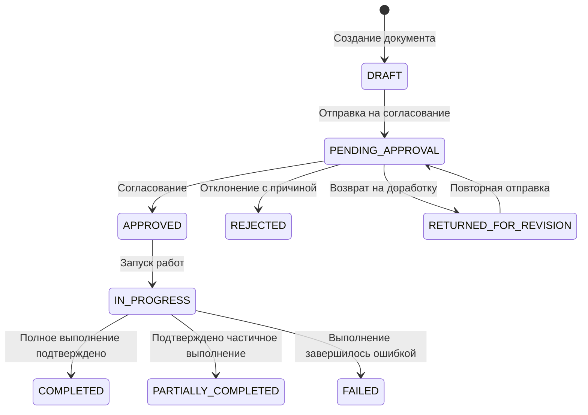
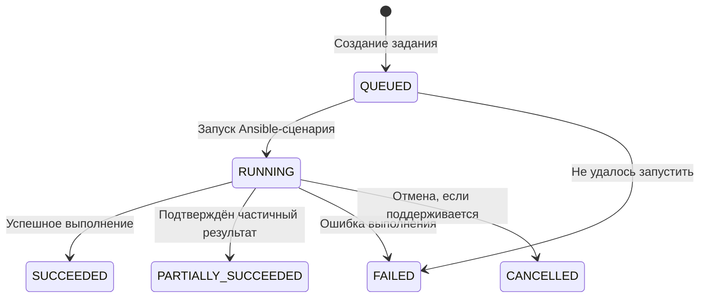
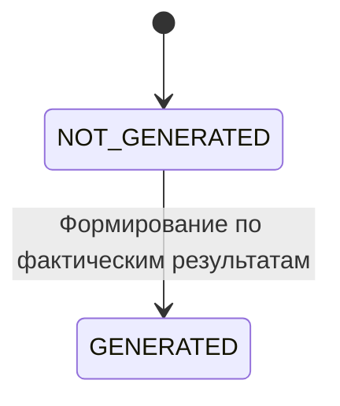
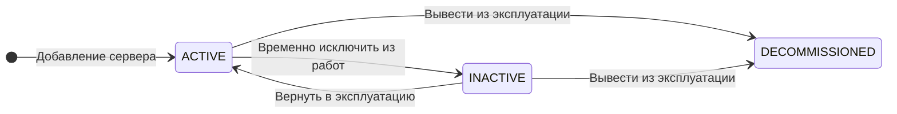
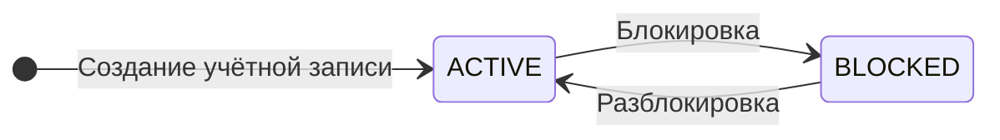
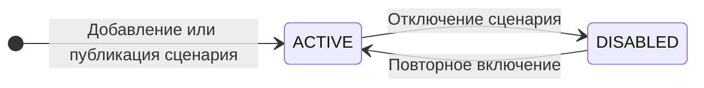

# Жизненные циклы сущностей системы

## 1. Назначение

Документ описывает проектные жизненные циклы основных сущностей информационной системы документооборота предприятия с модулем автоматизации конфигурации серверной инфраструктуры. Он дополняет варианты использования и матрицу разграничения прав доступа.

Не все статусы и переходы прямо закреплены в текущих требованиях. Предлагаемые положения отмечены в тексте и подлежат уточнению при проектировании бизнес-логики.

## 2. Жизненный цикл документа

Документ проходит путь от черновика до согласования, выполнения инфраструктурных работ и фиксации результата. Запуск работ разрешён только для согласованного документа и при соблюдении проверок прав, целевых серверов, параметров и выбранного Ansible-сценария.

### 2.1. Состояния документа

| Статус | Значение |
|---|---|
| `DRAFT` | Документ создан, но не отправлен на согласование. |
| `PENDING_APPROVAL` | Документ ожидает решения согласующего. |
| `RETURNED_FOR_REVISION` | Документ возвращён инициатору для исправления. Предлагаемый статус: процедура возврата требует уточнения. |
| `REJECTED` | Документ отклонён с указанием причины. |
| `APPROVED` | Документ согласован и допускает выполнение работ при соблюдении остальных условий. |
| `IN_PROGRESS` | Инфраструктурные работы выполняются. |
| `PARTIALLY_COMPLETED` | Подтверждено частичное выполнение работ. |
| `COMPLETED` | Полное выполнение подтверждено результатами задания. |
| `FAILED` | Выполнение завершилось неуспешно. |

`RETURNED_FOR_REVISION`, `PARTIALLY_COMPLETED` и `FAILED` уточняют предполагаемую бизнес-логику. Их окончательное использование следует согласовать с правилами возврата документа и дальнейших действий после частичного или неуспешного выполнения.

### 2.2. Диаграмма состояний документа

### 2.3. Правила переходов

1. Новый документ создаётся в состоянии `DRAFT`.
2. Отправка на согласование допускается после проверки обязательных полей и допустимости отправки.
3. Решение принимает уполномоченный согласующий. Он не может согласовать или отклонить собственный документ.
4. Отклонение сопровождается причиной; решение сохраняется в истории операций.
5. Работы запускаются только для согласованного документа, при наличии прав пользователя, целевых серверов, корректных параметров и разрешённого сценария.
6. Статус должен отражать фактический результат. Частичное или неуспешное выполнение нельзя обозначать как полное успешное выполнение.
7. Отмена документа и правила повторного запуска здесь не фиксируются: соответствующие полномочия и условия пока не определены.

## 3. Жизненный цикл задания на выполнение работ

Задание представляет отдельный запуск Ansible-сценария. Его состояние отражает результат конкретной попытки, а не только общее состояние документа. Повторный запуск, если он разрешён, рекомендуется оформлять новым заданием, связанным с тем же документом, чтобы сохранить историю предыдущих попыток.

### 3.1. Состояния задания

| Статус | Значение |
|---|---|
| `QUEUED` | Задание создано и ожидает запуска. |
| `RUNNING` | Ansible-сценарий выполняется. |
| `SUCCEEDED` | Задание завершено успешно. |
| `PARTIALLY_SUCCEEDED` | Подтверждён частичный результат. |
| `FAILED` | Задание не удалось запустить либо выполнение завершилось ошибкой. |
| `CANCELLED` | Задание отменено. Условия отмены требуют уточнения. |

### 3.2. Диаграмма состояний задания

### 3.3. Правила выполнения и повторного запуска

- Перед созданием задания система проверяет статус документа, права пользователя, целевые серверы, параметры и доступность разрешённого сценария.
- Через интерфейс нельзя запускать произвольные команды: допускаются только предусмотренные и разрешённые Ansible-сценарии.
- Система сохраняет статус, доступные журналы и итоговый результат.
- Результаты по отдельным серверам фиксируются настолько подробно, насколько позволяют данные выполнения.
- Результат повторного запуска не должен перезаписывать результаты предыдущего задания.
- Автоматический откат после ошибки не предполагается: его необходимость определяется требованиями конкретного сценария.
- Возможность отмены задания, повторного запуска после частичного результата и условия безопасного повтора требуют уточнения.

## 4. Жизненный цикл электронного акта

Электронный акт формируется по исходному документу и фактическим результатам выполнения работ. Он может отражать частичное или неуспешное выполнение, если система располагает достаточными сведениями.

### 4.1. Состояния акта

| Статус | Значение |
|---|---|
| `NOT_GENERATED` | Акт ещё не сформирован. |
| `GENERATED` | Акт сформирован и связан с исходным документом и результатами выполнения. |

### 4.2. Диаграмма состояний акта

### 4.3. Правила формирования акта

1. Акт формируется после завершения задания, когда имеются достаточные сведения о результате.
2. Акт отражает фактический результат, включая ошибки и частичное выполнение, если они имели место.
3. При недостатке данных система сообщает о невозможности сформировать акт.
4. Сформированный акт нельзя редактировать напрямую.
5. Исправление или повторное формирование выполняется по предусмотренной процедуре с сохранением истории. Модель версий или корректирующих актов требует отдельного определения.

## 5. Состояния связанных сущностей

Следующие статусы предлагаются для проектирования и должны быть подтверждены при уточнении требований.

### 5.1. Сервер

| Статус | Значение |
|---|---|
| `ACTIVE` | Сервер активен и может рассматриваться как целевой для разрешённых работ. |
| `INACTIVE` | Сервер временно не используется для новых работ. |
| `DECOMMISSIONED` | Сервер выведен из эксплуатации. |

Возврат из `DECOMMISSIONED` в рабочее состояние в этой модели не предусмотрен.

### 5.2. Учётная запись пользователя

| Статус | Значение |
|---|---|
| `ACTIVE` | Пользователь может авторизоваться при корректных учётных данных. |
| `BLOCKED` | Вход пользователя заблокирован. |

Назначение ролей и изменение прав — отдельные административные операции, а не состояния учётной записи.

### 5.3. Ansible-сценарий

| Статус | Значение |
|---|---|
| `ACTIVE` | Сценарий доступен для выбора при выполнении разрешённых работ. |
| `DISABLED` | Сценарий временно недоступен для новых запусков. |

Полномочия на создание и изменение содержимого сценариев пока не определены. Диаграмма описывает только предполагаемую доступность сценария.

## 6. Общие правила учёта состояний

- Состояния меняются через предусмотренные бизнес-операции, а не путём произвольного редактирования статуса.
- При смене состояния сохраняются сведения об операции, времени и пользователе в соответствии с требованиями к журналу аудита.
- Проверки прав выполняются на серверной стороне.
- Роль администратора системы сама по себе не даёт права согласовывать документы или запускать инфраструктурные работы.
- Результаты задания связываются с соответствующим документом.
- Электронный акт должен соответствовать фактическим результатам, а история повторных запусков и исправлений должна сохраняться.

## 7. Вопросы, требующие уточнения

1. **Возврат на доработку:** может ли согласующий возвращать документ, кто редактирует его после возврата и как документ повторно отправляется на согласование.
2. **Повторное выполнение:** кто вправе инициировать повторный запуск и при каких результатах (`FAILED` или `PARTIALLY_SUCCEEDED`).
3. **Отмена:** допускается ли отмена документа после согласования и можно ли прервать запущенное задание.
4. **Несколько заданий:** допускаются ли последовательные задания по одному документу и какие условия должны выполняться между попытками.
5. **Электронный акт:** оформляется ли исправление новой версией акта или отдельным корректирующим документом.
6. **Сценарии Ansible:** кто вправе добавлять, изменять, включать и отключать сценарии.

До уточнения этих вопросов диаграммы следует считать проектной моделью жизненных циклов, согласованной с текущими вариантами использования в основной части, но не окончательной спецификацией всех переходов.
